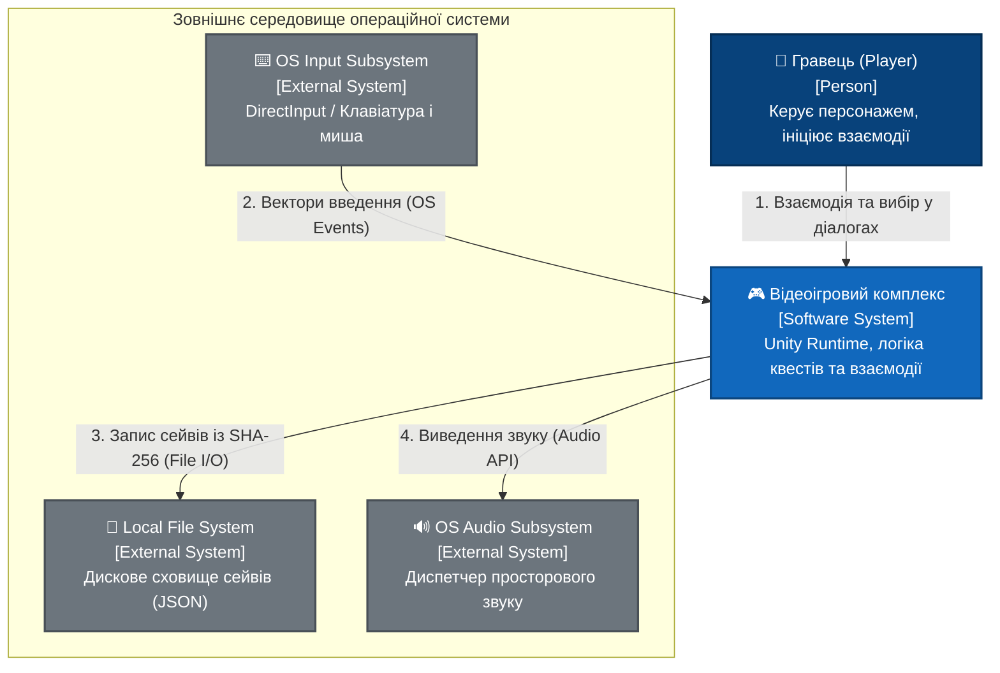
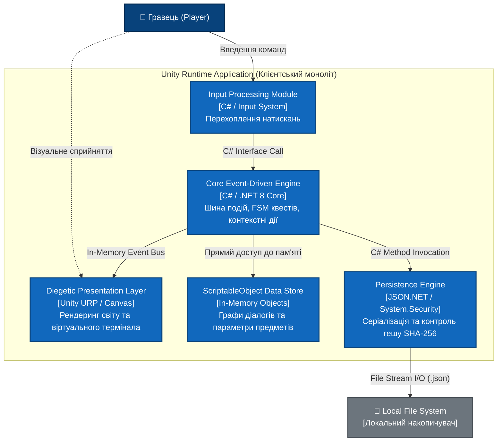
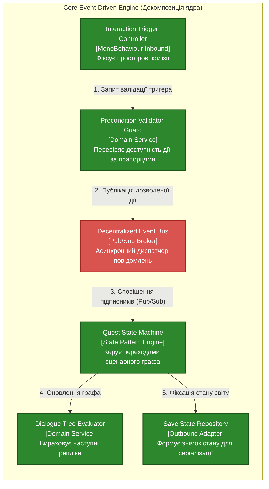

# РОЗДІЛ 2. АРХІТЕКТУРНЕ ПРОЄКТУВАННЯ СИСТЕМИ (C4 MODEL)

Даний розділ містить специфікацію архітектури системи відповідно до C4 Model із наскрізним трасуванням вимог контракту [srs.md](srs.md) та рішень [ADR-001](adr/0001-choice-of-technology.md).

---

## 2.1. Контекстне та контейнерне моделювання (C4 Levels 1–2)

### Рівень 1: System Context Diagram (Діаграма контексту)

Трасування вимог: Контекстна модель охоплює загальні межі взаємодії користувача згідно з SRS: Розділ 1 (System Context).
Рівень 2: Container Diagram (Діаграма контейнерів)

Трасування вимог: Контейнер UIMod реалізує вимогу ізоляції віртуального термінала SRS-FUN-06; контейнер StorageMod реалізує транзакційне збереження SRS-FUN-07 та контроль цілісності SRS-NFR-SEC-01.
## 2.2. Компонентне моделювання критичного ядра (C4 Level 3: Component)

Трасування вимог та архітектурних рішень:
Компонент Bus реалізує рішення ADR-001.
Компонент Ctrl реалізує вимогу контекстного моніторингу SRS-FUN-01.
Компонент Guard реалізує валідацію передумов дій SRS-FUN-02.
Компонент FSM забезпечує роботу скінченних автоматів квестів SRS-FUN-04.
